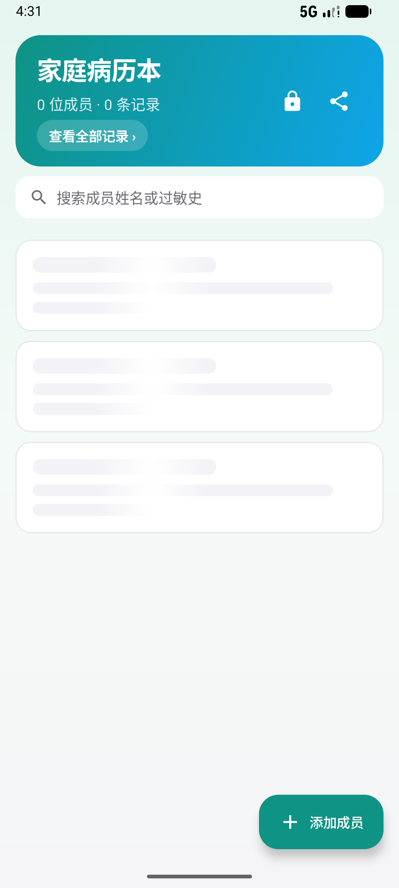
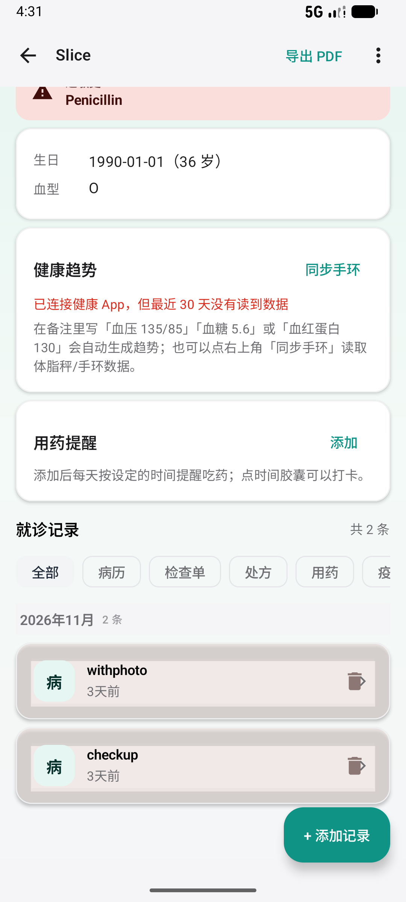
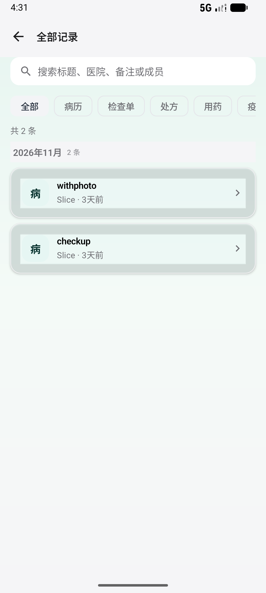
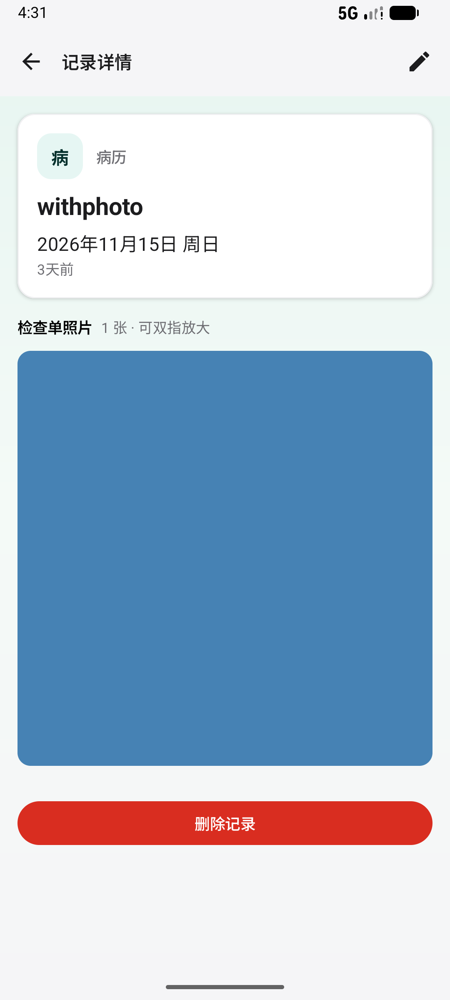
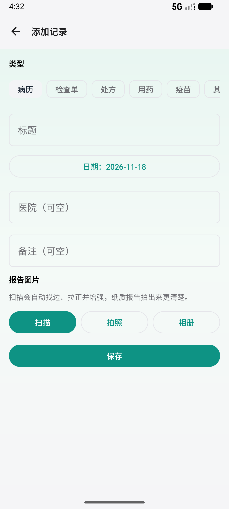
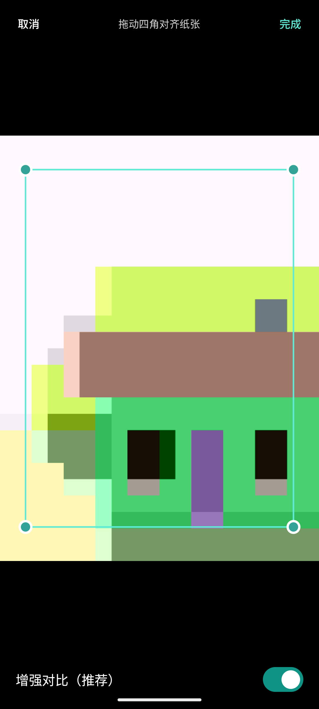
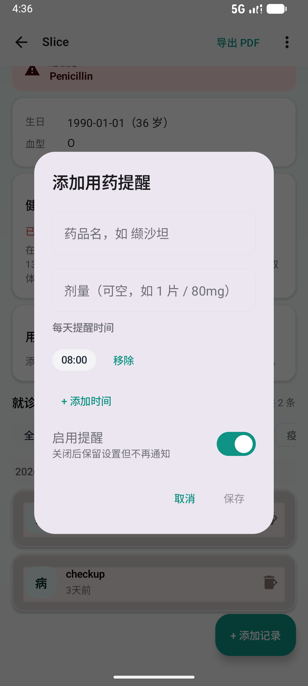
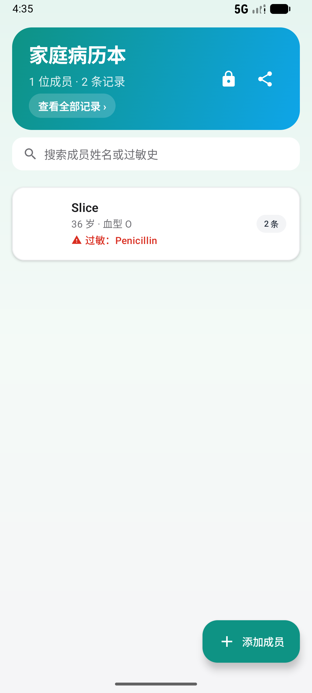
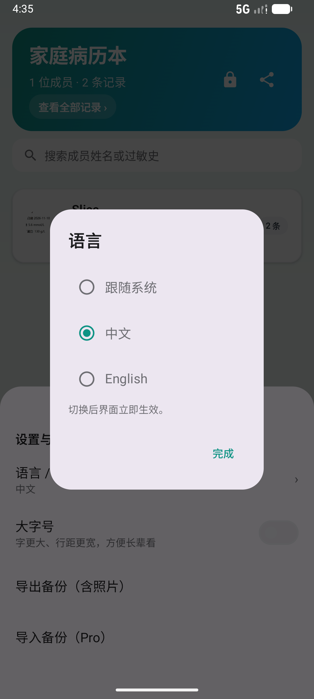

# 功能详解 · Feature Guide

> 家庭病历本 / Family Health Records · v0.3.0
> 截图位于 `docs/screenshots/`，可对照阅读。

---

## 中文

### 1. 成员列表（01-member-list.png）



- 顶部渐变 Hero：成员数、记录总数、「查看全部记录 ›」入口。
- 搜索框：按成员姓名、过敏史实时过滤（200ms 防抖）。
- 成员卡片：头像（可自定义或首字）、姓名、`36 岁 · 血型 O`、红色 `⚠ 过敏：xxx`、记录数胶囊。
- 右下角「添加成员」；超过免费额度（2 位）弹出 Pro。
- 空态有 Lottie 动画 + 引导文案；首次加载显示骨架屏。
- 支持下拉刷新、卡片逐条淡入、按压缩放。

### 2. 成员详情（02-member-detail.png）



- 资料卡：大头像、姓名、`年龄 · 血型`。
- 过敏史独立红色警示条（带图标），比普通信息更醒目。
- 信息卡：生日（附年龄）、血型、备注。
- **健康趋势**：从记录备注里提取血压/血糖/血红蛋白，Canvas 折线图，支持指标切换、最新值、较上次差值、首末日期；右上角「同步手环」走 Health Connect 授权与读取。
- **用药提醒**：药品名/剂量/时间胶囊/开关；近 7 天依从率；点时间胶囊打卡。
- 就诊记录：按「2026年11月」分组，卡片显示类型徽标、标题、`医院 · 2天前`、箭头；左滑删除需确认。

### 3. 全部记录（03-all-records.png）



- 跨成员聚合，按月份分组，显示成员名 + 相对日期。
- 搜索范围：标题、医院、备注、成员名。
- 类型筛选 chips（病历/检查单/处方/用药/疫苗）。

### 4. 记录详情（04-record-detail.png）



- 类型徽标 + 大标题 + `2026年11月15日 周日` + 相对时间。
- 医院/备注分块展示，备注可长按复制。
- 检查单照片：可双指缩放、拖动；标注「N 张」。
- 删除记录需二次确认（记录 + 照片一起删除）。

### 5. 记录表单（05-record-form.png）



- 类型 chips；标题、日期（日期选择器）、医院、备注。
- 报告图片区：
  - **扫描**：相机 → 校正页 → 增强，保存为扫描件；
  - **拍照**、**相册**：普通图片，入库时自动压缩到 ≤2400px 并纠正 EXIF 方向；
  - **增强**：把已选图片转成黑白高对比；
  - **识别文字**：OCR 识别并自动填日期/医院/标题（Pro）。
- 扫描完成后弹「继续扫描下一页」，支持多页报告连续录入。
- 保存时若标题为空会提示；保存成功返回上一页。

### 6. 扫描校正（06-scan-crop.png）



- 拍照后进入全屏校正页，四角可拖动，默认内缩 8%。
- 拖动限制在各自半区，避免四角交叉产生无效四边形。
- 底部「增强对比」开关；「完成」后按 2600px 重新加载原图做透视变换（`Matrix.setPolyToPoly`），再输出 JPEG。
- 取消/返回会清理相机临时文件。

### 7. 用药提醒（07-reminder-dialog.png）



- 药品名、剂量（可空）、每天多个提醒时间（时间选择器）、启用开关。
- 编辑模式支持删除；提醒卡片上可直接开关或点时间打卡。
- 通知：高优先级渠道、两个动作（已服用 / 10 分钟后再提醒）、点击回到 App。
- 到点后自动排到次日；重启手机、改时间/时区、App 升级后自动重排。
- 精确闹钟不可用时降级为非精确，并在卡片上提示去开启。

### 8. 设置与备份（08-settings.png）



- 语言 / Language：中文、English、跟随系统（立即生效）。
- 大字号：整体字号 ×1.16，行高同步放大，适合长辈。
- 导出备份（含照片）：打包 `data.json` + `media/` 为 zip，走系统分享。
- 导入备份（Pro）：选择 zip 后重建成员/记录/照片，并提示导入条数。

### 9. 语言切换（09-language.png）



- `Lang` + `T(zh, en)`：偏好存 SharedPreferences，切换后 Compose 立即重组。
- 日期、年龄、计数、通知文案都有英文分支。
- 启动器名称通过 `values-en` 资源跟随系统语言。

### 10. 隐私与安全

- PIN 应用锁：4–6 位数字，SHA-256 存储；切后台（ON_STOP）立即重锁；「忘记密码」可通过手机锁屏/指纹验证后重设（数据保留）。
- 跳相机/相册/分享/Play 购买时短暂免重锁（3 秒窗口），返回后正常锁定。
- 锁定时不渲染页面内容，避免弹窗盖在锁屏上。
- `allowBackup=false` + `fullBackupContent=false`，病历不进云备份。
- 备份文件由用户主动导出/保存，App 无上传逻辑。

### 11. 数据模型与迁移

- `Member`：姓名、生日、血型、过敏、备注、头像。
- `Record`：成员、类型、标题、日期（epochDay）、医院、备注。
- `RecordImage`：记录图片（相对文件名）、排序。
- `MedReminder`：药品、剂量、时间列表、启用。
- `MedDose`：提醒 + 日期 + 时间 + 状态（唯一索引防重复打卡）。
- 数据库版本 4，逐级迁移：头像列 → 提醒表 → 打卡表。

### 12. 备份格式

```
backup.zip
├── data.json          # app/version/members/records/avatar/images
└── media/             # 照片与头像（文件名即 data.json 中的引用）
```

导入时重建媒体文件并映射新文件名；成员/记录/打卡数据按 JSON 还原。

### 13. 测试与验证

- 单元测试：日期/年龄解析、OCR 字段抽取、指标解析、依从率计算、PDF 内容构建。
- 已人工验证：数据库迁移、扫码流程、通知触发与动作、Health Connect 授权、中英切换、应用锁端到端。

### 14. 已知限制

- 无云同步/多设备；家庭共享依赖导出 zip。
- 扫描需要手动调四角。
- OCR 结构化针对中文报告；英文报告仅保留全文。
- PDF 中文字体依赖系统 Skia 的 Type3 字形输出。

---

## English

### 1. Member list

Gradient hero with counts and an "all records" entry; debounced search over names/allergies; member cards with avatar, age/blood type, allergy warning and record-count pill; FAB to add; Pro paywall at the free limit; Lottie empty state, skeleton loading, pull-to-refresh.

### 2. Member detail

Profile card, prominent allergy banner, info card (birthday + age, blood type, notes), health-trend card (BP/glucose/hemoglobin line chart with deltas and Health Connect sync), medication reminders with time chips and 7-day adherence, records grouped by month with type badges and relative dates.

### 3. All records

Cross-member timeline grouped by month, search over title/hospital/notes/member, type filter chips.

### 4. Record detail

Type badge, title, localized full date + relative time, hospital/notes sections with selectable notes, zoomable report photos, confirmed deletion.

### 5. Record form

Type chips, title/date/hospital/notes, and an image section with: **Scan** (camera → crop → enhance), **Camera**, **Gallery**, **Enhance** (grayscale/contrast), **Recognize text** (Pro OCR auto-fill). After a scan it offers to continue with the next page.

### 6. Scan crop

Full-screen corner adjustment (default 8% inset, quadrant-clamped to prevent crossing), enhancement toggle, perspective transform on a 2600px reload, JPEG output, temp-file cleanup on cancel.

### 7. Medication reminders

Drug/dose/multiple daily times/enabled switch; notification actions (Taken, Snooze 10 min); automatic next-day rescheduling; boot/time-change rescheduling; exact-alarm fallback with an in-app hint; check-in chips and adherence.

### 8. Settings & backup

Language (Chinese/English/system), large-text mode, ZIP export (JSON + media), ZIP import (Pro) with a result toast.

### 9. Localization

`Lang` + `T(zh, en)` with SharedPreferences persistence and instant recomposition; localized dates, ages, counts and notifications; launcher name via `values-en`.

### 10. Privacy & security

PIN lock (SHA-256, auto-relock on background, forgot-PIN via device credential), lock overlay hides content, `allowBackup=false`, no upload logic, user-initiated backups only.

### 11. Data model

`Member`, `Record`, `RecordImage`, `MedReminder`, `MedDose` (unique index on reminder/date/time). Room schema v4 with incremental migrations.

### 12. Backup format

`data.json` + `media/` inside a ZIP; import rebuilds media and remaps filenames.

### 13. Testing

Unit tests for date/age parsing, OCR field extraction, vital parsing, adherence and PDF content; manual verification of migrations, scanning, notifications, Health Connect, language switching and app lock.

### 14. Limitations

No cloud sync; manual corner crop; Chinese-oriented OCR extraction; PDF CJK rendering relies on Skia Type3 glyphs.
