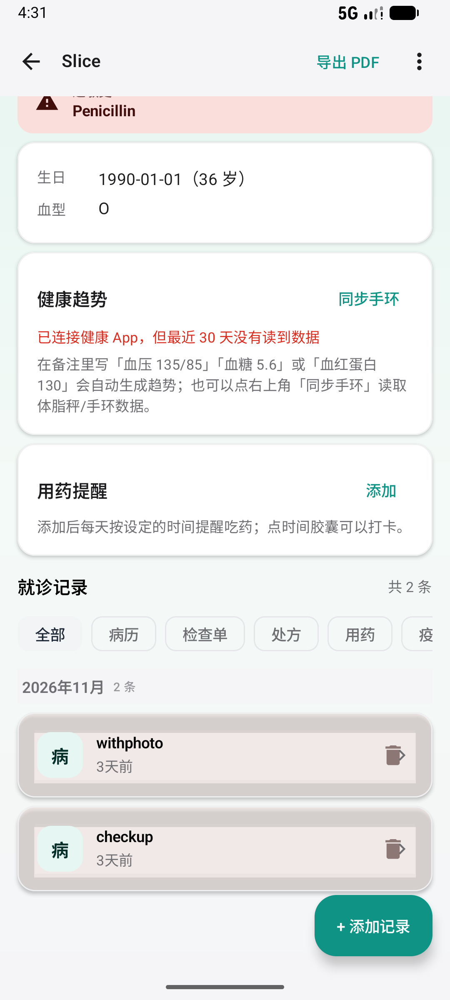
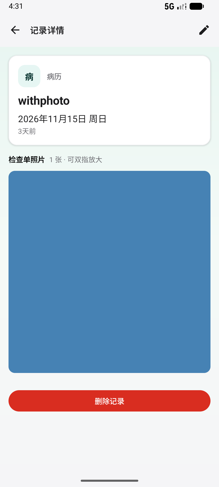
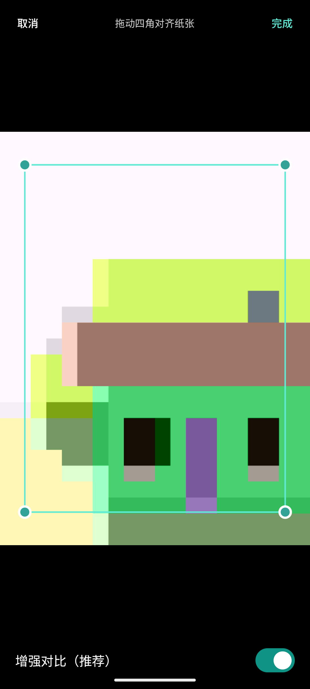
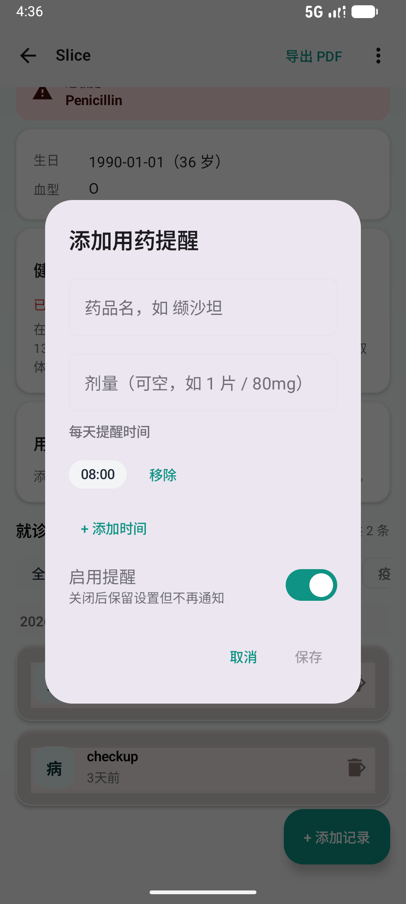
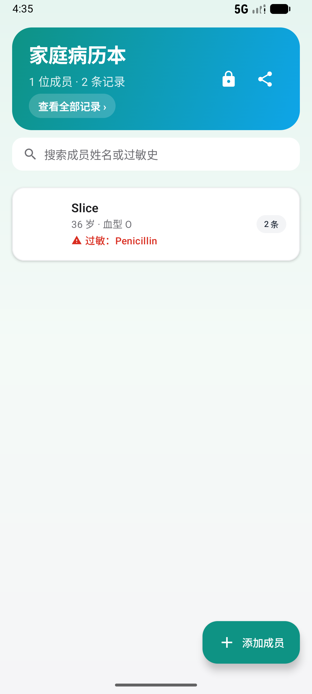
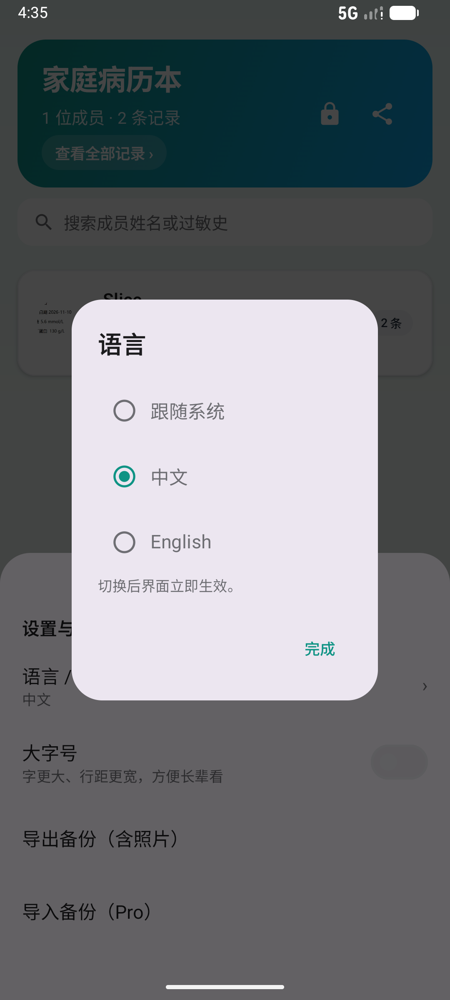
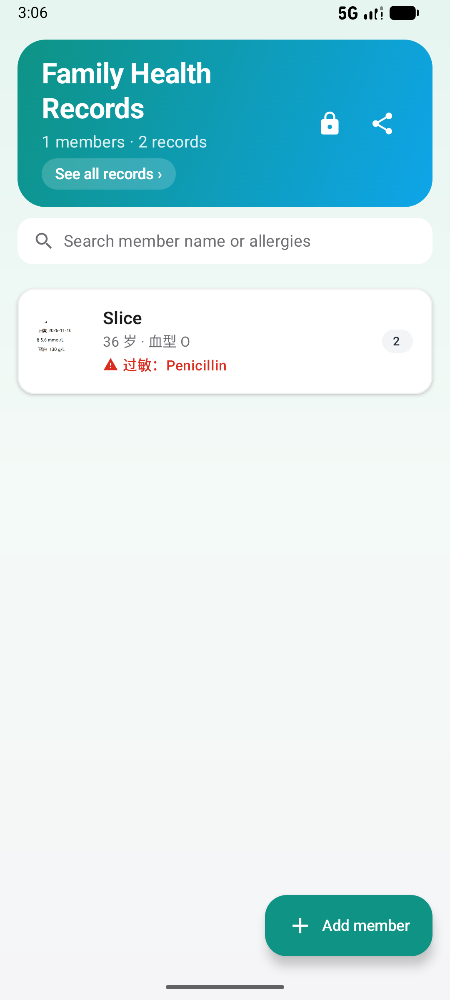
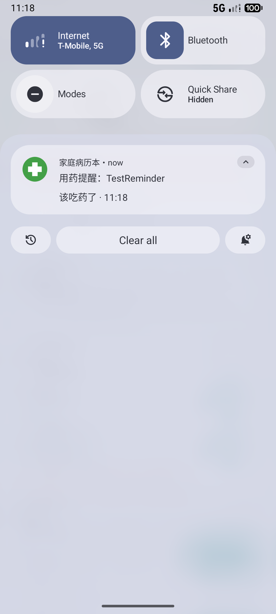

# 家庭病历本 · Family Health Records

一个**完全离线**的家庭健康档案 Android App：把散落的检查单、处方、体检报告整理成按人、按时间归档的病历，支持扫描校正、OCR 自动填表、用药提醒打卡、健康趋势、PDF 导出和中英文界面。

A **fully offline** family health record app for Android. It organizes scattered reports, prescriptions and checkups into per-member timelines, with document scanning, OCR auto-fill, medication reminders, health trends, PDF export and a Chinese/English UI.

<p>


</p>

---

## 中文

### 它解决什么问题

家里老人的检查单、孩子的疫苗本、自己的体检报告，通常散落在相册、微信和纸质袋子里。真到复诊、转院、给医生看时，翻不到、看不全、说不清。

这个 App 做三件事：

1. **拍清楚**：内置扫描校正，把斜着拍的纸拉正、去底色、提清晰度；
2. **存明白**：按成员归档，自动识别日期/医院/标题，按月份分组，日期显示成「3 天前」；
3. **用得上**：一键导出给医生看的 PDF，用药按时提醒并能打卡，指标自动生成趋势。

**所有数据只存在手机本地，不联网、无账号、无云同步。**

### 功能一览

| 模块 | 说明 |
|---|---|
| 多成员档案 | 头像、生日（自动算年龄）、血型、过敏史（红色警示条） |
| 记录管理 | 病历/检查单/处方/用药/疫苗，增删改查、左滑删除（带确认） |
| 全局记录 | 跨成员搜索、按月份分组、相对日期 |
| 文档扫描 | 拍照 → 四角透视校正 → 去色增强，输出清晰扫描件 |
| OCR 自动填表 | 中文 OCR 识别日期、医院、报告标题，只填空字段 |
| 健康趋势 | 从备注提取血压/血糖/血红蛋白，Canvas 折线图 |
| 手环数据 | Health Connect 读取体脂秤/手环的体重、心率、血压、血糖 |
| 用药提醒 | 每天多个时间点，通知内「已服用 / 10 分钟后再提醒」，7 天依从率 |
| PDF 导出 | 成员档案 + 记录 + 照片，免费版带页脚水印 |
| 备份恢复 | zip（JSON + 照片）导入/导出 |
| 隐私 | PIN 应用锁、切后台重锁、系统备份关闭、截图外不联网 |
| 无障碍/适老 | 大字号模式、TalkBack 语义、48dp 触控区 |
| 国际化 | 中文 / English / 跟随系统 |

### 截图

| 成员列表 | 成员详情 | 全部记录 |
|---|---|---|
|  |  |  |

| 记录详情 | 记录表单 | 扫描校正 |
|---|---|---|
|  |  |  |

| 用药提醒 | 设置与备份 | 语言切换 |
|---|---|---|
|  |  |  |

| 英文界面 | 用药通知 |
|---|---|
|  |  |

### 技术栈

- Kotlin 2.0 + Jetpack Compose (Material 3)
- Room 2.7（v4，含 1→2→3→4 迁移）+ KSP
- MVVM + StateFlow + Repository
- ML Kit 中文文字识别（离线）
- Health Connect（Android 14+）
- AlarmManager + BroadcastReceiver（精确闹钟/重启恢复）
- Google Play Billing 7（一次性买断，Debug 可本地解锁）
- Coil、Lottie、ExifInterface

### 构建

```bash
# JDK 17+
./gradlew assembleDebug
# 产物：app/build/outputs/apk/debug/app-debug.apk
```

需要 Android SDK 36。首次运行会创建本地数据库；相机/通知权限在对应功能触发时申请。

### 隐私说明

- 无网络权限用于业务数据（仅 Health Connect / 应用商店购买会走系统服务）
- `android:allowBackup="false"`，不会进系统云备份
- 应用锁 PIN 以 SHA-256 存储，切后台立即重锁
- 备份 zip 由用户主动导出，App 不上传

### 已知限制

- 无云同步/多设备共享（设计取舍：本地优先）
- 扫描为手动四角校正，未做自动边缘检测
- 仅 Android；iOS 需 Compose Multiplatform 或原生重写
- OCR 结构化依赖中文关键词，英文报告识别效果有限

### License

MIT

---

## English

### Why it exists

Hospital reports, prescriptions, vaccine records and checkups usually end up scattered across the gallery, chat apps and a paper bag. When you actually need them — a follow-up visit, a referral, a second opinion — they are hard to find and hard to read.

This app does three things:

1. **Capture cleanly** — built-in scan with four-corner perspective correction and contrast enhancement.
2. **Organize clearly** — per-member timeline, auto-extracted date/hospital/title, month grouping, relative dates.
3. **Make it useful** — one-page PDF for doctors, medication reminders with check-in, automatic vital trends.

**Everything stays on the device: no account, no cloud, no tracking.**

### Features

| Area | What it does |
|---|---|
| Members | Avatar, birthday (auto age), blood type, allergy warning banner |
| Records | Types, CRUD, swipe-to-delete with confirmation |
| Global search | Cross-member search, grouped by month |
| Document scan | Camera → 4-corner warp → grayscale/contrast enhancement |
| OCR autofill | Chinese OCR extracts date, hospital and report title; only fills blanks |
| Health trends | Extracts BP / glucose / hemoglobin from notes and draws a line chart |
| Health Connect | Reads weight, heart rate, BP and glucose from bands/scales |
| Medication | Multiple daily times, notification actions (Taken / Snooze 10 min), 7-day adherence |
| PDF export | Member profile + records + photos; free version adds a footer watermark |
| Backup | ZIP export/import including photos |
| Privacy | PIN lock with auto-relock, cloud backup disabled, offline by design |
| Accessibility | Large-text mode, semantics, 48dp touch targets |
| i18n | Chinese / English / follow system |

### Screenshots

See the table above — the UI is identical in both languages.

### Tech stack

Kotlin 2.0, Jetpack Compose, Room 2.7 (schema v4 with migrations), MVVM + StateFlow, ML Kit Chinese OCR (on-device), Health Connect, AlarmManager, Play Billing 7, Coil, Lottie.

### Build

```bash
./gradlew assembleDebug
```

Requires JDK 17 and Android SDK 36.

### Privacy

- `allowBackup=false`; no cloud backup of medical data
- PIN stored as SHA-256, re-locks on background
- Backups are user-initiated ZIP files; the app never uploads them

### Limitations

- No cloud sync or multi-device sharing (local-first trade-off)
- Manual four-corner crop; no automatic edge detection
- Android only
- OCR field extraction is tuned for Chinese reports

### License

MIT
