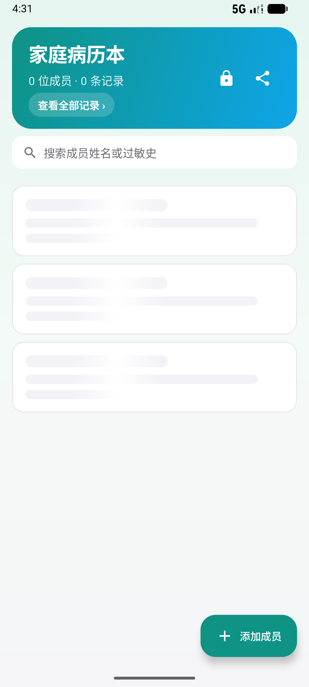
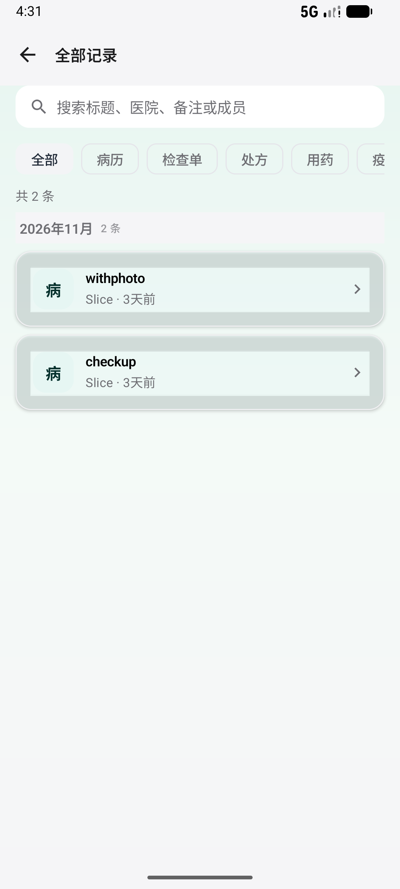
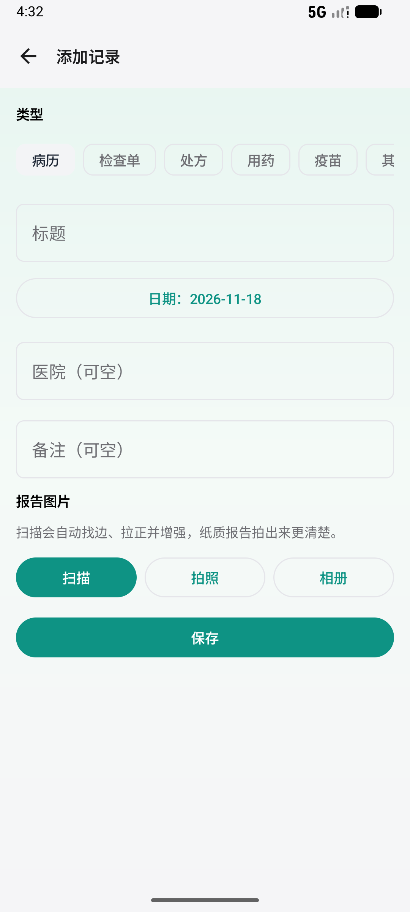

# 家庭病历本 · Family Health Records

一个**完全离线**的家庭健康档案 Android App：把散落的检查单、处方、体检报告整理成按人、按时间归档的病历，支持扫描校正、OCR 自动填表、用药提醒打卡、健康趋势、PDF 导出和中英文界面。

A **fully offline** family health record app for Android. It organizes scattered reports, prescriptions and checkups into per-member timelines, with document scanning, OCR auto-fill, medication reminders, health trends, PDF export and a Chinese/English UI.

<p>


</p>

---

## 功能导览 · Feature tour

### 1. 成员列表 · Member list



**中文**：顶部统计成员数与记录数，可直接进入「全部记录」；搜索按姓名/过敏史过滤；卡片显示头像、`36 岁 · 血型 O`、红色过敏警示和记录数。超过免费额度会弹出 Pro。

**English**: Counts, an all-records shortcut and debounced search. Each card shows avatar, age/blood type, an allergy warning and record count; the free tier limit opens the Pro dialog.

### 2. 成员详情 · Member detail


**中文**：资料卡 + 独立红色过敏条；生日自动算年龄；**健康趋势**从备注中提取血压/血糖/血红蛋白画折线，也能通过 Health Connect 读取体脂秤/手环；**用药提醒**按时间胶囊展示，点一下即可打卡；下方记录按月份分组。

**English**: Profile, a prominent allergy banner, auto age, a health-trend chart (parsed from notes or imported via Health Connect), medication time chips with one-tap check-in, and records grouped by month.

### 3. 全部记录 · All records



**中文**：跨成员聚合，按「2026年11月」分组，显示成员名 + 相对日期（今天/3天前）；支持按标题、医院、备注、成员名搜索和类型筛选。

**English**: A cross-member timeline grouped by month, with member name and relative dates, searchable by title/hospital/notes/member and filterable by type.

### 4. 记录详情 · Record detail


**中文**：类型徽标、大标题、`2026年11月15日 周日`；医院/备注分块，备注可长按复制；检查单照片支持双指缩放；删除需二次确认。

**English**: Type badge, title, localized full date, hospital/notes blocks with selectable text, zoomable report photos, and confirmed deletion.

### 5. 记录表单 · Record form



**中文**：类型 chips、日期选择器、医院、备注；图片区提供**扫描 / 拍照 / 相册 / 增强 / 识别文字**。扫描完成后可继续扫下一页；OCR 会把日期、医院、标题自动填入空字段（Pro）。

**English**: Type chips, date picker, hospital and notes, plus an image section with **Scan / Camera / Gallery / Enhance / Recognize text**. After each scan it offers the next page; OCR fills empty date/hospital/title fields (Pro).

### 6. 扫描校正 · Scan crop


**中文**：拍照后进入全屏四角校正，默认内缩 8%，每角限制在自己的半区避免交叉；「完成」后按 2600px 重新加载原图做透视变换，再输出增强后的 JPEG。

**English**: Full-screen corner adjustment (8% inset, quadrant-clamped), then a perspective transform on a 2600px reload and an enhanced JPEG output.

### 7. 用药提醒 · Medication reminders


**中文**：药品名、剂量、每天多个时间点、启用开关；通知里有「已服用 / 10 分钟后再提醒」两个动作；到点后自动排到次日，重启手机/改时区/升级后自动重排。

**English**: Drug, dose, multiple daily times and an enable switch. Notifications offer **Taken** and **Snooze 10 min**; schedules roll to the next day and survive reboots, timezone changes and app updates.

### 8. 设置与备份 · Settings & backup


**中文**：语言、大字号（整体 ×1.16，适合长辈）、导出备份（JSON + 照片 zip）、导入备份（Pro，重建成员/记录/照片）。

**English**: Language, large-text mode (×1.16 for older users), ZIP export (JSON + photos) and Pro import that rebuilds members, records and media.

### 9. 语言切换 · Language


**中文**：中文 / English / 跟随系统，切换后立即生效；日期、年龄、计数和通知文案都有英文分支。

**English**: Chinese / English / follow system, applied instantly; dates, ages, counts and notifications are localized too.

### 10. 英文界面 · English UI


**中文**：同一套界面在英文下的实际效果，布局与中文一致，日期显示为 `Today / Nov 2026`。

**English**: The same UI in English, including `Today` / `Nov 2026` date formatting.

### 11. 用药通知 · Medication notification


**中文**：高优先级通知，展示药品名、剂量与时间，并提供打卡/稍后提醒两个动作，点通知回到 App。

**English**: A high-priority notification with drug, dose and time, two actions, and a tap target back into the app.

---

## 技术栈 · Tech stack

- Kotlin 2.0 + Jetpack Compose (Material 3)
- Room 2.7（v4，含 1→2→3→4 迁移）+ KSP
- MVVM + StateFlow + Repository
- ML Kit 中文文字识别（离线）
- Health Connect（Android 14+）
- AlarmManager + BroadcastReceiver（精确闹钟/重启恢复）
- Google Play Billing 7（一次性买断，Debug 可本地解锁）
- Coil、Lottie、ExifInterface

## 构建 · Build

```bash
# 需要 JDK 17 与 Android SDK 36
./gradlew assembleDebug
# 产物：app/build/outputs/apk/debug/app-debug.apk
```

## 隐私 · Privacy

- 病历数据不存在云端：`allowBackup=false`
- 应用锁 PIN 以 SHA-256 存储，切后台立即重锁
- 备份 zip 由用户主动导出，App 无上传逻辑
- 相机/通知权限在对应功能触发时才申请

## 已知限制 · Limitations

- 无云同步/多设备共享（本地优先的设计取舍）
- 扫描需要手动调四角，未做自动边缘检测
- 仅 Android；iOS 需 Compose Multiplatform 或原生重写
- OCR 结构化针对中文报告，英文报告仅保留全文

## License

MIT
